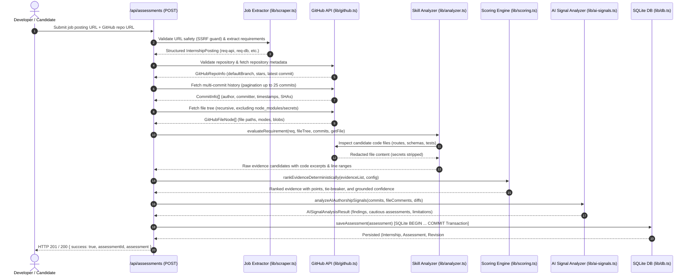
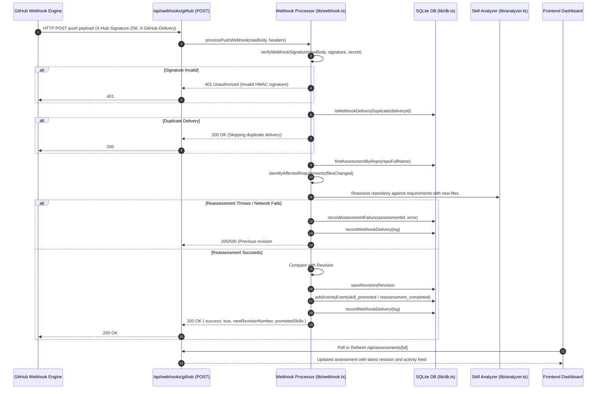

# ProofLoop End-to-End Data Flow

This document details the complete end-to-end data pipelines in ProofLoop: from repository inspection and webhook reception through evidence extraction, deterministic scoring, atomic persistence, and client response.

---

## 1. Initial Assessment Pipeline

---

## 2. GitHub Push Webhook & Reassessment Pipeline

---

## 3. Revision Comparison & Audit Trail Pipeline

1. **Request:** `GET /api/assessments/[id]/revisions/compare?from=1&to=2` (or `/api/assessments/[id]/compare?from=1&to=2`).
2. **Lookup:** `getRevisionByNumber(assessmentId, 1)` and `getRevisionByNumber(assessmentId, 2)`.
3. **Diff Analysis:**
   - **Added Evidence:** Requirements evaluated in Rev 2 that were not in Rev 1.
   - **Removed Evidence:** Requirements tracked in Rev 1 absent in Rev 2.
   - **Modified Evidence:** Requirements whose status (`partial` -> `demonstrated`), code file, or score changed.
   - **Score Delta:** Point variance per skill with clear attribution (code change vs scoring rule version update).
   - **Rule Version:** Compares `scoringRuleVersion` between revisions.
4. **Response:** Structured `RevisionComparison` object returned to client.

---

## 4. Deterministic Scoring Logic (`src/lib/scoring.ts`)

Every skill score is computed deterministically from versioned weights (`v2026.1`):

$$\text{Total Score} = \min(100, \text{BasePoints} + \text{TestBonus} + \text{ContinuityBonus})$$

- **Base Points:**
  - Strong implementation (active route handler, schema, component): **55 pts**
  - Moderate configuration (scaffolding, incomplete handler): **35 pts**
  - Weak dependency / documentation: **15 pts**
  - None: **0 pts**
- **Test Verification Bonus:**
  - Active test suite with assertions (`expect()`, `assert.`): **+25 pts**
  - Test files without verified assertion statements: **+10 pts**
- **Continuity Bonus:**
  - Corroborated across 3+ commits: **+20 pts**
  - Corroborated across 2 distinct commits: **+15 pts**
  - Single commit: **+5 pts**
- **Status Classification:**
  - $\text{Score} \ge 70 \implies \mathbf{demonstrated}$
  - $30 \le \text{Score} < 70 \implies \mathbf{partial}$
  - $\text{Score} < 30 \implies \mathbf{not\_demonstrated}$
- **Tie-Breaking Hierarchy:**
  1. Primary: Total Score (descending)
  2. Secondary: Test Verification Bonus (descending)
  3. Tertiary: Base Implementation Points (descending)
  4. Quaternary: Multi-commit Continuity Bonus (descending)
  5. Quinquennial: Requirement Title Alphanumeric (ascending)
